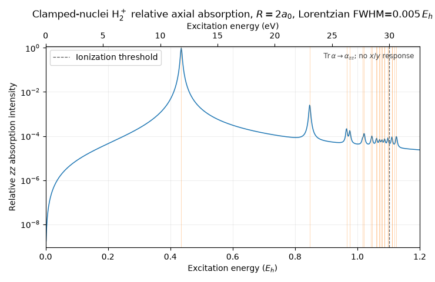

# One-electron diatomic stationary-state validation

The `grid_tdse.spherical.one_radial` and
`grid_tdse.prolate_spheroidal` packages represent the clamped-nuclei
one-electron Hamiltonian

```math
H=-\frac{1}{2\mu}\nabla^2
-\frac{Z_1}{|\mathbf r-\mathbf R_A|}
-\frac{Z_2}{|\mathbf r-\mathbf R_B|},
```

where

```math
\mathbf R_A=(0,0,-a),\qquad
\mathbf R_B=(0,0,a),\qquad
R=2a.
```

This document validates the spherical and prolate-spheroidal implementations
for H2+ stationary states at `R=2` bohr, with `Z1=Z2=1`, `a=1`, `mu=1`.
The clamped-nuclei total energy is

```math
E_{\mathrm{BO}}=\epsilon_0+\frac{1}{R},
```

where `epsilon_0` is the electronic eigenvalue.

## High-precision ground-state reference

Kullie reports the nonrelativistic electronic energy at `R=2` as

```math
\epsilon_{\mathrm{ref}}
=-1.10263421449494646150896894154\ E_h.
```

The corresponding clamped-nuclei total energy used below is therefore

```math
E_{\mathrm{ref}}
=-0.60263421449494646150896894154\ E_h.
```

Reference: O. Kullie, "High-precision minmax solution of the two-center
Dirac equation," *Physical Review A* **110**, 052808 (2024),
[doi:10.1103/PhysRevA.110.052808](https://doi.org/10.1103/PhysRevA.110.052808).
The reference calculation uses a two-centre finite-element representation
and reports the nonrelativistic limit separately from the relativistic
energy.

## Spherical one-radial ground-state validation

## Reproducing the validation

Run the complete validation with

```bash
python examples/spherical/one_radial/one_electron_diatomic_validation.py
```

The default calculation uses `p=21` for the radial-box and angular studies,
extends the orbital expansion through `l_max=60`, performs an independent
prolate-spheroidal calculation, and saves
`H2plus_spherical_convergence_R2.pdf`. The controls are listed by

```bash
python examples/spherical/one_radial/one_electron_diatomic_validation.py --help
```

The independent radial polynomial-order calculation is

```bash
python examples/spherical/one_radial/one_electron_diatomic_p_convergence.py \
    --l-max 4 \
    --p-max 41
```

The polynomial-order script uses the Poisson nuclear construction. The main
validation uses the analytic multipoles and separately compares them with the
Poisson construction.

## Radial polynomial order

For `l_max=4`, `L_max=8`, `r_max=16`, and element boundaries
`[0, 1, 2, 4, 8, 16]`, selected values from the odd-`p` sequence are

| `p` | Total energy (`E_h`) |
|---:|---:|
| 5  | -0.596366482310 |
| 7  | -0.596437582233 |
| 9  | -0.596437507539 |
| 13 | -0.596437507156 |
| 21 | -0.596437507153 |
| 41 | -0.596437507024 |

The radial error decreases rapidly through about `p=9`. At larger orders the
energy fluctuates on a scale of approximately `1e-10 E_h`; this is the
floating-point and conditioning floor of the high-order FEM-DVR and Poisson
matrices, not an angular-convergence result. The final value in the plot is a
finite-grid reference, so the relative-error curve becomes irregular after
reaching this floor.

## Radial box

With `p=21`, `l_max=12`, and the inner boundaries held fixed, extending the
outer boundary gives

| `r_max` (bohr) | Total energy (`E_h`) |
|---:|---:|
| 4  | -0.595920971981484 |
| 6  | -0.602080756714767 |
| 8  | -0.602136091231865 |
| 12 | -0.602136431169690 |
| 16 | -0.602136431169690 |

Thus, `r_max=12` is sufficient at the displayed precision for this fixed
angular cutoff.

## Radial element size

The element-size study keeps `r_max=16`, `p=7`, and `l_max=12`, while refining
the element layout without moving the nuclear boundary at `r=a=1`.

| Maximum element width (bohr) | Number of elements | Total energy (`E_h`) |
|---:|---:|---:|
| 8 | 5  | -0.602122627400778 |
| 4 | 10 | -0.602136270840137 |
| 2 | 20 | -0.602136431056216 |

The refined low-order sequence approaches the same fixed-`l_max` energy as
the polynomial-order study.

## Orbital angular cutoff

The midpoint one-centre expansion must represent electron-nuclear cusps at
two displaced points. Radial refinement cannot eliminate the resulting
partial-wave truncation error, and convergence with `l_max` is algebraic.
With `p=21`, `r_max=16`, and `L_max=2*l_max`, the principal results are

| `l_max` | Total energy (`E_h`) | Absolute reference error (`E_h`) |
|---:|---:|---:|
| 0  | -0.518502331446033 | 8.4132e-2 |
| 4  | -0.596437507162098 | 6.1967e-3 |
| 8  | -0.601263740383875 | 1.3705e-3 |
| 12 | -0.602136431169690 | 4.9778e-4 |
| 20 | -0.602507081701287 | 1.2713e-4 |
| 30 | -0.602593192801485 | 4.1022e-5 |
| 40 | -0.602616147687976 | 1.8067e-5 |
| 50 | -0.602624721678397 | 9.4928e-6 |
| 60 | -0.602628625001089 | 5.5895e-6 |

The sequence is monotone toward the high-accuracy result. At `l_max=60`, the
remaining error is about `9.3e-6` relative. This slow angular convergence is a
property of the midpoint spherical representation, rather than evidence of a
radial or nuclear-multipole error.

## Nuclear multipole cutoff

For orbital functions truncated at `l_max`, Gaunt selection rules imply that
nuclear multipoles above `L_max=2*l_max` have no projected action. At
`l_max=12`, the energy converges as follows:

| `L_max` | Total energy (`E_h`) |
|---:|---:|
| 0  | -0.518502331531511 |
| 4  | -0.594593284155860 |
| 8  | -0.600871971269661 |
| 12 | -0.601999880755671 |
| 16 | -0.602123119032873 |
| 20 | -0.602135177214181 |
| 22 | -0.602136186608644 |
| 24 | -0.602136431169690 |
| 26 | -0.602136431169690 |

Increasing the nuclear cutoff beyond `2*l_max=24` leaves the projected
Hamiltonian and energy unchanged.

## Analytic and Poisson nuclear potentials

For `p=21`, `l_max=12`, and `L_max=24`, the two constructions give

| Construction | Total energy (`E_h`) |
|---|---:|
| Analytic multipoles | -0.602136431169690 |
| Poisson solve | -0.602136431247889 |

Their difference is `7.82e-11 E_h`, below the angular truncation error by
more than six orders of magnitude.

## Independent prolate-spheroidal cross-check

The validation script also constructs the same Hamiltonian using grid-lib's
prolate-spheroidal weak-form operators. The nuclei coincide with the two
coordinate foci, so this calculation neither uses the midpoint spherical
partial-wave expansion nor its nuclear multipole representation. The default
prolate calculation gives

```text
Computed total energy:  -0.602634214495260 Eh
Published total energy: -0.602634214494946 Eh
Absolute difference:     3.140e-13 Eh
```

This independent coordinate representation confirms the Hamiltonian
conventions, the nuclear-repulsion shift, and the published benchmark. The
spherical sequence approaches the same value with its expected slower
angular convergence.

## Prolate-spheroidal stationary-state validation

The prolate-spheroidal implementation places the two nuclei at the coordinate
foci. It therefore represents both electron--nuclear singularities directly,
without the midpoint spherical partial-wave expansion or a nuclear
multipole cutoff.

### Davidson ground state

Run the user-facing Davidson calculation with

```bash
python examples/prolate_spheroidal/one_electron_diatomic_ground_state.py
```

The development calculation uses

```text
R:                            2 bohr
xi element boundaries:       [1, 4, 14, 24]
xi points per element:       14
eta Gauss--Legendre points:  9
m:                            0
active state shape:           (39, 9)
```

This compact grid gives

| Quantity | Calculated (`E_h`) | Kullie reference (`E_h`) | Difference (`E_h`) |
|---|---:|---:|---:|
| Electronic energy | -1.102634214485352 | -1.102634214494946 | 9.594e-12 |
| Total energy | -0.602634214485352 | -0.602634214494946 | 9.594e-12 |

The Davidson residual norm is `8.264e-11` for this run. The agreement should
be interpreted as a validation of the Hamiltonian, metric, boundary
conditions, and eigensolver on this grid. It is not a general convergence
claim for other bond lengths, charges, or excited states.

### Excitation energies from Tao, McCurdy, and Rescigno

Table II of Tao, McCurdy, and Rescigno reports selected H2+ electronic and
excitation energies at `R=2` bohr. Their fixed-nuclei time-dependent method
uses a finite-element DVR in prolate spheroidal coordinates. The present
comparison is reproduced with

```bash
python examples/prolate_spheroidal/one_electron_diatomic_excited_states.py
```

The comparison grid follows the published Table-I discretization used by the
grid-lib validation:

```text
xi elements:                  one element from 1 to 2,
                              ten equal elements from 2 to 80
xi points per element:       15
eta Gauss--Legendre points:  9
active state shape:           (154, 9) in each fixed-m sector
sectors:                      m=0 and m=1
```

The direct solver is used here as a deterministic validation oracle for the
low-lying spectrum. Davidson remains the default stationary-state solver.
Excitation energies are formed from the more precise calculated ground-state
energy,

```math
\Delta E_n = E_n-E_0,
\qquad
E_0=-1.102634214493190\ E_h.
```

The constant nuclear repulsion cancels in every excitation energy. The
published values are rounded to the digits shown in Table II.

| Table-II state | `m` | Calculated symmetry | Calculated `E_n` (`E_h`) | Table-II `E_n` (`E_h`) | Calculated `Delta E_n` (`E_h`) | Table-II `Delta E_n` (`E_h`) |
|---|---:|:---:|---:|---:|---:|---:|
| `2p sigma_u` | 0 | `u` | -0.667534392201 | -0.667534 | 0.435099822292 | 0.43510 |
| `3p sigma_u` | 0 | `u` | -0.255413165086 | -0.255413 | 0.847221049407 | 0.84722 |
| `4p sigma_u` entry | 0 | `g` | -0.177681045126 | -0.177681 | 0.924953169367 | 0.92495 |
| `4f sigma_u` | 0 | `u` | -0.126643870150 | -0.126644 | 0.975990344344 | 0.97599 |
| `2p pi_u` | 1 | `u` | -0.428771819896 | -0.428772 | 0.673862394597 | 0.67386 |
| `3p pi_u` | 1 | `u` | -0.200864829911 | -0.200865 | 0.901769384582 | 0.90177 |
| `4f pi_u` | 1 | `u` | -0.126198920530 | -0.126199 | 0.976435293964 | 0.97643 |

The largest difference from a printed Table-II excitation energy is
`5.3e-6 E_h`. This is consistent with the limited precision of the published
entries and the use of the more precise calculated ground-state energy.

There is one important state-label qualification. The numerical eigenstate
at `-0.177681045126 E_h`, which matches the energy printed for
`4p sigma_u`, has inversion expectation

```math
\langle P\rangle=+1,
```

and is therefore gerade. The nearest computed ungerade `Sigma` root instead
has

```text
E_n       = -0.137312924277 E_h
Delta E_n =  0.965321290216 E_h.
```

The example reports this as an apparent reference-label inconsistency rather
than silently assigning the published label by numerical proximity. Every
state in the comparison is classified using inversion of the computed
wavefunction. For a fixed magnetic quantum number, inversion combines
reflection of the prolate `eta` coordinate with the azimuthal phase
`(-1)^m`.

Reference: L. Tao, C. W. McCurdy, and T. N. Rescigno, "Grid-based methods
for diatomic quantum scattering problems. II. Time-dependent treatment of
single- and two-photon ionization of H2+," *Physical Review A* **80**,
013402 (2009),
[doi:10.1103/PhysRevA.80.013402](https://doi.org/10.1103/PhysRevA.80.013402).

### Delta-kick real-time spectral validation

Three related spectrum constructions are used here. They have the same
linear-response limit but must not be conflated: the eigenstate construction
is the reference result, the one-sided kick is the protocol described by
Repisky et al., and the paired-kick construction is an additional numerical
central difference used to qualify the propagator.

All three use the axial interaction `H(t)=H0+E(t)z`. A field impulse with
integrated area `K` applies the exact nodal transformation

```math
\Psi(0^+)=\exp(-iKz)\Psi_0,
\qquad
z=a\xi\eta.
```

For a causal response `chi_zz(t)`, introduce exponential damping with
Lorentzian FWHM `Gamma` and define

```math
\widetilde{\chi}_{zz}^{(\Gamma)}(\omega)
=\int_0^T
e^{i\omega t}e^{-\Gamma t/2}
[\chi_{zz}(t)-\chi_{zz}(0)]\,dt.
```

The axial contribution to the absorption-strength function is

```math
S_{zz}(\omega)
=\frac{4\pi\omega}{3c}
\mathrm{Im}\,\widetilde{\chi}_{zz}^{(\Gamma)}(\omega).
```

The implementation stores the transform with the `exp(-i*omega*t)` FFT
convention, so it uses `-Im` of that stored transform. Equation (24) of
Repisky et al. contains the full Cartesian trace. Only `alpha_zz` is computed
here; no `x`- or `y`-polarized propagation is implied.

#### Eigenstate construction: reference spectrum

Diagonalization supplies excitation energies
`omega_n0 = E_n-E_0` and transition moments `z_n0 = <n|z|0>`. The exact
linear response within that finite eigenstate basis is

```math
\chi_{zz}^{\mathrm{eig}}(t)
=2\sum_{n>0}|z_{n0}|^2\sin(\omega_{n0}t).
```

Fourier transforming this response with the damping above is equivalent to
placing Lorentzian lines at the eigenstate excitation energies with weights
set by the transition moments. It is independent of propagation time-step,
Krylov, CAP, and finite-kick errors. It is therefore the reference spectrum
against which both real-time constructions are assessed. It remains subject
to the finite spatial grid, number of eigenstates, and chosen Lorentzian
width.

The figure below compares all three constructions on the `T=2000` Step-11
time grid with `Gamma=0.005 E_h`. The black curve is the 80-state eigenstate
reference. The dashed orange curve is the one-sided positive-kick result,
and the dotted blue curve is the paired-kick result. All curves use the
eigenstate maximum as their common normalization; they are not independently
rescaled. The single logarithmic axis exposes weak higher excitations without
changing their relative scale. Thin orange lines mark dipole-active ungerade
stationary states, and the dashed gray line marks the ionization threshold.
The lower, linear subplot shows the signed one-sided-minus-paired difference
on the same common normalization, making their otherwise visually hidden
finite-kick and numerical differences explicit.

The comparison is generated from the completed propagation archive with

```bash
python \
    examples/prolate_spheroidal/h2plus_delta_kick_absorption_spectrum.py \
    --propagation-archive \
    output/step11_qualification/reference/response.npz \
    --plot docs/images/h2plus_axial_absorption_spectrum.png
```



*Eigenstate-reference, one-sided-kick, and paired-kick axial absorption
spectra for clamped-nuclei H2+ at `R=2 a0`, with Lorentzian FWHM
`0.005 E_h`. The lower panel is the signed difference between the two
propagated spectra. Only the molecular-axis response is included; no
perpendicular polarization was computed.*

For `K=1e-3`, the one-sided and paired propagated time responses agree to
`9.25e-9` in relative L2. After applying the same damping and common
eigenstate normalization, each propagated spectrum differs from the
eigenstate reference by `1.75e-4` in relative L2 over the plotted interval.
The visible residual differences occur mainly in the discretized continuum
above the ionization threshold.

#### One-sided delta kick: Repisky protocol

For one positive weak kick, record the propagated dipole `d_K(t)`. The
finite-kick estimate is

```math
\chi_{zz}^{(+)}(t)
=\frac{d_K(t)-d_K(0)}{K}
=\chi_{zz}(t)+O(K).
```

Fourier transformation and damping of this induced dipole response give the
polarizability used in the absorption-strength expression above. Repisky et
al. describe this one-kick real-time protocol, with separate kicks required
for the Cartesian components used in the full trace. The present axial
calculation would require only the `z` kick and yields the `zz` contribution.
The displayed `O(K)` is the generic one-sided finite-difference error. For
inversion-symmetric H2+, the axial dipole is odd in `K`, so symmetry removes
the even response terms and the leading finite-kick error is already
`O(K^2)`.

Reference: M. Repisky, L. Konecny, M. Kadek, S. Komorovsky, O. L. Malkin,
V. G. Malkin, and K. Ruud,
"Excitation Energies from Real-Time Propagation of the Four-Component
Dirac--Kohn--Sham Equation," *Journal of Chemical Theory and Computation*
**11**, 980--991 (2015),
[doi:10.1021/ct501078d](https://doi.org/10.1021/ct501078d).

#### Paired delta kicks: propagation qualification

The Step-11 workflow instead performs two independent calculations, one
with `+K` and one with `-K`, and forms

```math
\chi_{zz}^{(\pm)}(t)
=\frac{d_{+K}(t)-d_{-K}(t)}{2K}
=\chi_{zz}(t)+O(K^2).
```

These are not two sequential pulses and do not describe a two-pulse physical
experiment. They are two separately propagated initial-value problems. The
central difference cancels the even powers of `K`, giving a more accurate
linear-response estimate for a general system. For H2+, it additionally
provides a direct antisymmetry check rather than changing the formal order
already imposed by inversion symmetry. This paired-kick refinement is used
by grid-tdse; it is not the protocol described by Repisky et al.

Run it with

```bash
python \
    examples/prolate_spheroidal/h2plus_delta_kick_spectrum.py
```

The example uses the same Tao-comparable `R=2` grid and constructs the ground
state with Davidson. The defaults compare `K=1e-3` and `K=5e-4`, propagate
for `1000` a.u. with SIA, and use a cubic CAP. A no-kick run checks that the
CAP does not affect the ground state. The output archive contains the raw
induced responses, positive-frequency transforms, norm histories,
CAP-region probabilities, CAP norm-loss rates, and JSON metadata. The
accompanying plot marks the allowed ungerade `Sigma` excitation energies and
the symmetry-forbidden gerade root at `0.924953169367 E_h`.

| Construction | Time-domain input | Leading finite-kick error | Role here |
|---|---|---:|---|
| eigenstate | stationary energies and transition moments | none | reference spectrum |
| one-sided kick | `[d_K(t)-d_K(0)]/K` | generic: `O(K)`; H2+: `O(K^2)` | Repisky real-time protocol |
| paired kicks | `[d_+K(t)-d_-K(t)]/(2K)` | `O(K^2)` | propagation qualification |

For a rapid workflow test, use

```bash
python \
    examples/prolate_spheroidal/h2plus_delta_kick_spectrum.py \
    --final-time 20 \
    --time-step 0.1 \
    --kick-strengths 1e-3 \
    --output H2plus_delta_kick_smoke.npz \
    --plot H2plus_delta_kick_smoke.pdf
```

This short run does not have enough frequency resolution to validate the
excitation energies. For a propagation duration `T`, the nominal Fourier
spacing is `2*pi/T`; window broadening must also be included when setting
peak tolerances. The two near-threshold allowed roots at approximately
`0.9653` and `0.9760 E_h` may require `T=2000` a.u. or a separately validated
harmonic-fitting analysis.

#### Production delta-kick qualification

Step 11 was qualified on 2026-11-15 using a `T=2000`, `dt=0.1` propagation
baseline and independent `T=1000` controls. This numerical baseline is
distinct from the eigenstate reference spectrum above. Each calculation uses
the same grid and ground state, SIA with a maximum Krylov dimension of 50,
and paired analytic axial kicks. Threaded numerical libraries were restricted
to one thread per independent trajectory.

| Case | `T` | `dt` | `xi_max` | Outer `xi` elements | CAP onset fraction | CAP strength |
|---|---:|---:|---:|---:|---:|---:|
| propagation baseline | 2000 | 0.1 | 80 | 10 | 0.80 | `1e-3` |
| time-step control | 1000 | 0.05 | 80 | 10 | 0.80 | `1e-3` |
| onset control | 1000 | 0.1 | 80 | 10 | 0.75 | `1e-3` |
| strength control | 1000 | 0.1 | 80 | 10 | 0.80 | `2e-3` |
| box control | 1000 | 0.1 | 100 | 13 | 0.80 | `1e-3` |

The propagation baseline uses both `K=1e-3` and `K=5e-4`. Its relative L2
kick-sign antisymmetry errors are `9.25e-9` and `1.00e-9`, respectively. The
two central-difference responses agree to `8.75e-7` in relative L2. The
no-kick final norm differs from unity by `1.79e-14`.

The complete-record Fourier spacing is `0.00314159 E_h`. The late record
starts at `t=500` and has spacing `0.00418879 E_h`. Local spectral maxima are

| State | Stationary `Delta E` (`E_h`) | Full-record peak (`E_h`) | Absolute error | Late-record peak (`E_h`) | Absolute error |
|---|---:|---:|---:|---:|---:|
| `2p sigma_u` | 0.435099822292 | 0.433539786195 | 0.00156004 | 0.435634181298 | 0.000534359 |
| `3p sigma_u` | 0.847221049407 | 0.848230016469 | 0.00100897 | 0.846135621367 | 0.00108543 |
| additional `Sigma_u` root | 0.965321290216 | 0.964468944652 | 0.000852346 | 0.963421747101 | 0.00189954 |
| `4f sigma_u` | 0.975990344344 | 0.977035315266 | 0.00104497 | 0.975988117715 | 0.00000223 |

Every peak is within one Fourier bin of its stationary value in both
records. Full-versus-late shifts are at most `0.00209440 E_h`, also less than
one late-record bin. At the symmetry-forbidden gerade energy, the sampled
full-record power is `3.15e-6` of the weakest allowed peak and
`1.21e-14` of the dominant allowed peak; it is not a local maximum in the
complete spectrum.

Relative L2 changes of the entire `T=1000` response from the reference are

| Control | Relative L2 response change | Shift of either resolved low peak |
|---|---:|---:|
| `dt=0.05` | `1.67e-4` | 0 Fourier bins |
| CAP onset `0.75` | `2.96e-5` | 0 Fourier bins |
| CAP strength `2e-3` | `1.13e-5` | 0 Fourier bins |
| `xi_max=100` | `8.63e-5` | 0 Fourier bins |

During the final quarter of the reference propagation, the mean CAP loss
rate is `6.16e-5` of its maximum and the mean CAP-region probability is
`2.93e-4` of its maximum. This confirms that the initial outgoing transient
has been absorbed before the late-record analysis.

The machine-readable report is generated with

```bash
python \
    examples/prolate_spheroidal/analyze_h2plus_delta_kick_qualification.py \
    output/step11_qualification
```

It enforces all 15 kick, spectrum, symmetry, absorber, time-step, and box
acceptance gates and writes
`output/step11_qualification/qualification_report.json`.

### Heteronuclear two-centre validation

The same Hamiltonian implementation supports unequal positive charges. The
heteronuclear comparison is reproduced with

```bash
python \
    examples/prolate_spheroidal/one_electron_diatomic_heteronuclear_validation.py
```

Every case uses `m=0` and the same validation grid:

```text
xi element boundaries:       [1, 4, 14, 24]
xi points per element:       18
eta Gauss--Legendre points:  24
```

Campos et al. tabulate nonrelativistic electronic eigenvalues for HeH2+,
LiH3+, and BeH4+ at fixed internuclear distances. Their convention excludes
the nuclear repulsion. The clamped-nuclei total energy reported here is

```math
E_{\mathrm{BO}}=E_{\mathrm{el}}+\frac{Z_1Z_2}{R}.
```

The direct eigensolver is used as a deterministic validation oracle. The
results are

| System | State | `R` (bohr) | Root in `m=0` sector | Calculated `E_el` (`E_h`) | Reference `E_el` (`E_h`) | Absolute error (`E_h`) | Calculated `E_BO` (`E_h`) |
|---|---|---:|---:|---:|---:|---:|---:|
| HeH2+ | `1s sigma` | 2 | 0 | -2.512193016590 | -2.512193016590 | 3.14e-13 | -1.512193016590 |
| LiH3+ | `1s sigma` | 2 | 0 | -5.002042016848 | -5.002042016849 | 8.29e-13 | -3.502042016848 |
| LiH3+ | `1s sigma` | 4 | 0 | -4.750111784802 | -4.750111784789 | 1.34e-11 | -4.000111784802 |
| BeH4+ | `1s sigma` | 2 | 0 | -8.500592345518 | -8.500592345526 | 7.99e-12 | -6.500592345518 |
| BH5+ | `3p sigma` | `sqrt(10)/3` | 4 | -2.000000000000 | -2 exactly | 1.32e-13 | 2.743416490252 |

The largest electronic-energy discrepancy is `1.34e-11 E_h`, while the
largest eigenstate residual in the recorded run is `1.05e-12`. These results
validate unequal charges, the charge-dependent nuclear-repulsion shift, and
low excited-state ordering in the fixed-`m` representation.

The BH5+ entry is qualitatively different from the other entries. Khoma
reports Demkov's exact analytic solution for `Z1=1`, `Z2=5`,
`R=sqrt(10)/3`, and the `3p sigma` state:

```math
E_{\mathrm{el}}=-2\ E_h,
\qquad
\lambda=-\frac{10}{3}.
```

The calculated state is root 4 when the `m=0` eigenvalues are sorted in
ascending order. It provides an exact heteronuclear excited-state benchmark,
whereas the other four entries test tabulated ground-state energies.

References:

- J. A. Campos, D. L. Nascimento, D. T. Cavalcante, A. L. A. Fonseca,
  and A. O. C. Nunes, "Determination of Electronic Energy Levels for the
  Heteromolecular Ions HeH2+, LiH3+, and BeH4+ From the Hamilton--Jacobi
  Equation," *International Journal of Quantum Chemistry* **106**, 2587--2596
  (2006),
  [doi:10.1002/qua.21015](https://doi.org/10.1002/qua.21015).
- M. V. Khoma, "Generalized spheroidal wave equation for real and complex
  valued parameters. An algorithm based on the analytic derivatives for the
  eigenvalues," [arXiv:2503.18280](https://arxiv.org/abs/2503.18280).

### Matched target-family dynamics validation

The field-free and real-time paths are additionally tested in one matched
calculation for H2+, LiH3+, and BH5+:

```bash
python \
    examples/prolate_spheroidal/one_electron_diatomic_family_validation.py \
    --output one_electron_diatomic_family_validation.json
```

All three systems use `R=2`, `m=0`, the charge ordering shown below, and the
same numerical parameters:

```text
xi element boundaries:       [1, 4, 14, 24]
xi points per element:       14
eta Gauss--Legendre points:  16
pulse:                       SineSquareLaser
E0, omega, cycles, phase:    0.01, 4, 1, pi/2
propagator:                  SIA
time step:                   0.05
```

The direct ground state supplies the initial condition. No absorber is used
in this deliberately short, unitary propagation. The results are

| System | `(Z1,Z2)` | `E_el` (`E_h`) | `<I>` | Initial total `d_z` | Final ground-state survival | Origin phase error |
|---|---:|---:|---:|---:|---:|---:|
| H2+ | `(1,1)` | -1.102634214485 | 1.0000000 | -0.0000000 | 0.999982825 | 6.18e-15 |
| LiH3+ | `(3,1)` | -5.002042016864 | 0.0668093 | -1.0146605 | 0.999998405 | 7.23e-15 |
| BH5+ | `(5,1)` | -13.000234679086 | 0.0024184 | -3.0018099 | 0.999999974 | 7.74e-15 |

The H2+ and LiH3+ electronic energies differ from their reference values by
`9.59e-12 E_h` and `1.49e-11 E_h`, respectively. The BH5+ value in this
table is its ground state on the matched `R=2` grid; it is not the exact
Demkov `3p sigma` benchmark at `R=sqrt(10)/3` discussed above. All three
residual norms are below `2.2e-13`, and the largest propagation norm error is
`1.8e-14`.

Inversion is an exact symmetry for the homonuclear H2+ Hamiltonian, giving
`<I>=1` for its ground state. The heteronuclear Coulomb term proportional to
`(Z2-Z1) eta` breaks that symmetry. The substantially noninteger inversion
expectations for LiH3+ and BH5+ explicitly confirm the expected parity
mixing; their dynamics must not be restricted to one `eta` parity.

The family test also makes the charged-system origin bookkeeping explicit.
For an axial origin displaced by `z0` from the bond midpoint,

```math
d_{\mathrm n}(z_0)
=d_{\mathrm n}(0)-(Z_1+Z_2)z_0,
```

```math
d_{\mathrm e}(z_0)
=d_{\mathrm e}(0)-q_{\mathrm e}z_0,
```

and therefore

```math
d_{\mathrm{tot}}(z_0)
=d_{\mathrm{tot}}(0)-Q_{\mathrm{tot}}z_0.
```

Including both the electronic and static nuclear terms changes the
length-gauge Hamiltonian only by the scalar
`E(t) Q_tot z0`. Consequently, an origin shift changes the wavefunction by
the predicted global phase while leaving all observables invariant after
the corresponding dipole translation. With `z0=0.25`, the largest
phase-aligned state error is `7.74e-15`, and the largest origin-corrected
total-dipole discrepancy is `8.88e-16`.

### Axial length- and velocity-gauge equivalence

For a clamped one-electron target, the implemented axial gauges are

```math
H_L(t)=H_0+E_z(t)z,
```

and

```math
H_V(t)=H_0-A_z(t)\frac{q_e}{\mu}p_z,
\qquad
E_z(t)=-\frac{dA_z(t)}{dt}.
```

For an electron, `q_e=-1`, so the linear velocity-gauge interaction is
`A_z(t) p_z / mu`. The spatially uniform
`q_e^2 A_z(t)^2/(2 mu)` term is omitted. It contributes only a global phase,
which is why final states are phase-aligned before their norm difference is
reported. The complete pulse used below has `A_z(0)=A_z(t_final)=0`.

The prolate momentum operator is not formed by applying a pointwise
coordinate transformation to a derivative. `grid-lib` constructs the weak
matrix from

```math
\frac{\partial}{\partial z}
=
\frac{\eta(\xi^2-1)}{a(\xi^2-\eta^2)}
\frac{\partial}{\partial\xi}
+
\frac{\xi(1-\eta^2)}{a(\xi^2-\eta^2)}
\frac{\partial}{\partial\eta},
```

then enforces the discrete integration-by-parts relation before multiplying
by `-i`. The resulting weak matrix is Hermitian. Its strong form is Hermitian
in the diagonal prolate overlap metric, and its symmetric form is ordinarily
Hermitian. Tests cover `m=0,+/-1`, inversion oddness, and metric Hermiticity.

Run the matched qualification with

```bash
python \
    examples/prolate_spheroidal/h2plus_length_velocity_gauge.py \
    --output H2plus_length_velocity_gauge.json \
    --archive H2plus_length_velocity_gauge.npz \
    --plot H2plus_length_velocity_gauge.pdf
```

The system is H2+ at `R=2`, `m=0`. Both gauges use the same three-cycle
`SineSquareLaser` with `E0=0.05`, `omega=0.8`, and phase zero. SIA propagates
the state through the complete pulse. The development qualification uses
the following controls:

| Case | `xi` boundaries | Points/element | `eta` degree | `dt` |
|---|---|---:|---:|---:|
| reference | `[1,2,4,8,12,16]` | 9 | 13 | 0.05 |
| coarse time step | `[1,2,4,8,12,16]` | 9 | 13 | 0.10 |
| compact box | `[1,2,4,8,12]` | 9 | 13 | 0.05 |
| lower resolution | `[1,2,4,8,12,16]` | 7 | 9 | 0.05 |

The HHG comparison uses the normalized dipole-form quantity

```math
I(\omega)=\omega^4
\left|\mathcal F\left[
w(t)(d_z(t)-d_z(0))
\right]\right|^2,
```

with a Hann window. It is normalized to unit maximum between harmonic orders
0.5 and 8. This short, high-frequency calculation tests gauge equivalence;
it is not an HHG production-convergence claim.

| Case | Electronic-energy error (`E_h`) | `1 -` final fidelity | Dipole relative L2 | HHG RMS difference |
|---|---:|---:|---:|---:|
| reference | `4.12e-11` | `3.30e-13` | `4.61e-5` | `1.11e-5` |
| coarse time step | `4.12e-11` | `4.75e-10` | `1.85e-4` | `4.49e-5` |
| compact box | `4.99e-11` | `7.11e-14` | `4.61e-5` | `1.11e-5` |
| lower resolution | `5.29e-9` | `1.17e-10` | `4.61e-5` | `1.11e-5` |

The reference norm errors are below `5.2e-14`, and its phase-aligned final
state difference is `5.75e-7`. Halving the time step reduces both the dipole
and HHG gauge discrepancies by approximately a factor of four, as expected
for the second-order propagation comparison. Relative to the reference, the
largest compact-box dipole change is `3.87e-5` and the largest corresponding
HHG RMS change is `2.74e-6`; the lower-resolution changes are smaller than
`7.7e-7` and `1.3e-7`, respectively. The field-free, norm, final-state,
dipole, spectrum, time-step, box, and resolution acceptance gates all pass.
